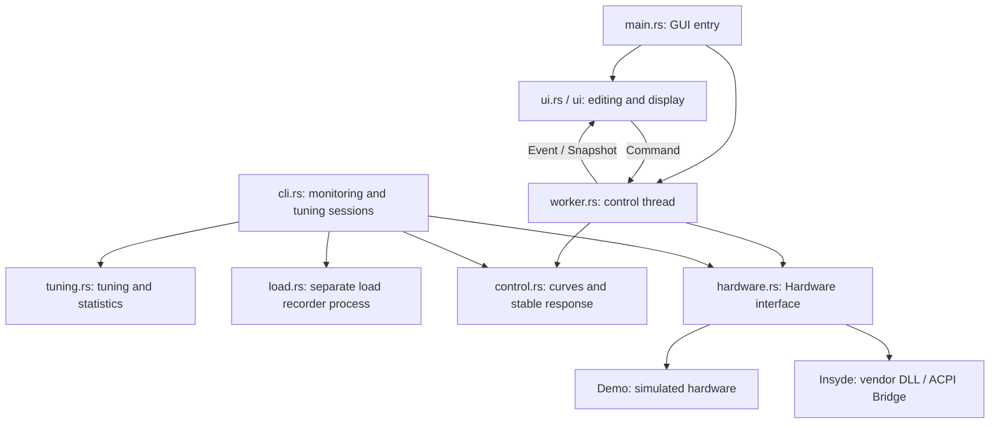

# Architecture and Code Navigation

This document describes the current implementation to help locate future changes. See the [development guide](../CONTRIBUTING.md) for builds and checks, and the [README](../README.md) for user behavior and diagnostic arguments.

## Entry Points and Dependency Direction

The repository is one Cargo package with a shared library and two executables. The GUI runs by default; select the CLI with `--bin clevo-fan-cli`. They share algorithms, configuration, and hardware interfaces, but organize execution separately.

`config.rs` provides configuration models, validation, and persistence for the UI, control, and CLI. `platform.rs` centralizes Windows integration. Their shared dependency edges are omitted from the diagram.

## Module Responsibilities

| File | Main responsibilities and change entry points |
| --- | --- |
| `src/main.rs` | GUI startup, single-instance lock, configuration loading, diagnostic arguments, and compatibility checks |
| `src/lib.rs` | Shared modules exposed to both executables and integration tests |
| `src/ui.rs` | FLTK main window, editing draft, configuration application, and worker event handling |
| `src/ui/dialogs.rs` | Supporting UI dialogs |
| `src/ui/history.rs` | Sample history, missing data, and chart rendering |
| `src/worker.rs` | GUI control thread, preset selection, sampling schedule, takeover, and restoration state |
| `src/control.rs` | Curve calculation, hysteresis, stable response, forced cooling completion, and duty conversion |
| `src/config.rs` | Configuration types, defaults, validation, atomic saves, legacy import, and wildcards |
| `src/hardware.rs` | `Hardware` abstraction, real DLL loading and validation, sampling, fan writes, and simulated implementation |
| `src/platform.rs` | Single-instance enforcement, process enumeration, vendor path discovery, tray, power events, auto-start, and system appearance |
| `src/cli.rs` | Arguments, session files, stop requests, restoration guard, and monitoring/tuning loops |
| `src/tuning.rs` | Tuning seeds, local curve adjustments, sample and temperature checks, and statistics |
| `src/load.rs` | CPU utilization and NVIDIA GPU queries; load recording separate from EC control |
| `src/recording.rs` | Optional GUI history, nonblocking bounded producer, writer status, versioned files, rotation and retention |
| `src/preferences.rs` | Last committed settings snapshot used by recording-only preference transactions |
| `build.rs`, `app.manifest` | Windows icon and manifest; Debug uses caller privileges, Release requests administrator privileges |

## State Boundaries

The GUI editing draft is separate from the worker's active configuration. Save and Apply submits edits; toggling takeover and automatic preset matching must not implicitly submit the draft. When changing configuration flow, inspect both action handling in `ui.rs` and `Command` branches in `worker.rs`.

The worker owns the hardware object, receives `Command`, and returns state through `Event` and `Snapshot`. Snapshots separately preserve curve demand, actual request, and sampled readback values; these can differ during stable response or high-temperature protection. The UI displays events; the control thread handles scheduling and hardware interaction.

GUI history uses a separate `Command::Recording` sink. Acquisition is enqueued before subsequent hardware calls; start/result events preserve the associated observation sequence. Verification-triggering samples are retained without adding reads. All storage and retention run in one writer thread; a full queue drops diagnostic records instead of delaying control. Complete state checkpoints at segment boundaries and after loss/context changes keep retained files interpretable. Recording status is independent of the worker's hardware fault latch. Normal exit restores first, then allows at most two seconds for writer finalization.

Recording-only saves use the last committed configuration, not the mutable GUI settings or curve draft. They share the existing single-save gate with full saves and update only the recording preference on completion. Full saves update the committed snapshot; valid reloads synchronize it, and GUI legacy imports preserve the independent recording preference. Recording-only saves never send `Command::Settings`, clear unrelated dirty state or register auto-start. Disabling stops current recording even if preference persistence fails; the UI warns about the next-launch saved value.

The CLI does not use the GUI `Worker`. Its own session loop combines shared control algorithms, tuning, and hardware interfaces. Check both GUI and CLI when changing shared algorithms, and inspect both entry points separately when changing scheduling or restoration paths. The CLI outputs candidate configurations without directly overwriting user configuration.

## Hardware and Evidence Boundaries

`Hardware` isolates hardware implementations through `sample`, `write`, `automatic`, and `description`. `Demo` and worker test doubles support simulated validation. `Insyde` validates the model, DLL path, and hash before accessing hardware through installed vendor components.

The GUI and CLI share the application's single-instance lock. This lock does not prevent other software such as FnKey/Control Center from accessing the EC. Automatic restoration is an operation whose result must be checked; execution is not guaranteed after a crash, forced termination, or a hung DLL/driver.

See the [historical research record](../CONTROL_OWNERSHIP_RESEARCH.md) for protocol and ownership research, and the [validation record](NH5XAX.md) for NH5xAx hardware evidence. Limit compatibility and restoration conclusions to the machines, component versions, and scenarios recorded there.

## Test Locations

- `tests/core.rs`: public behavior including curves, hysteresis, stable response, high-temperature protection, configuration validation, and import.
- `tests/nh5xax.rs`: model name matching boundaries for default compatibility rules.
- Tests in `src/worker.rs`: takeover, restoration, and fault behavior with simulated hardware.
- Tests in `src/tuning.rs`, `src/cli.rs`, and `src/load.rs`: tuning, arguments, load calculations, and related logic.
- Tests in `src/hardware.rs` and UI modules: compatibility helpers, appearance, history, and other local behavior.

Automated checks do not start real control sessions. Desktop integration, real hardware, and long-term operation require separate acceptance and evidence appropriate to the change scope.
